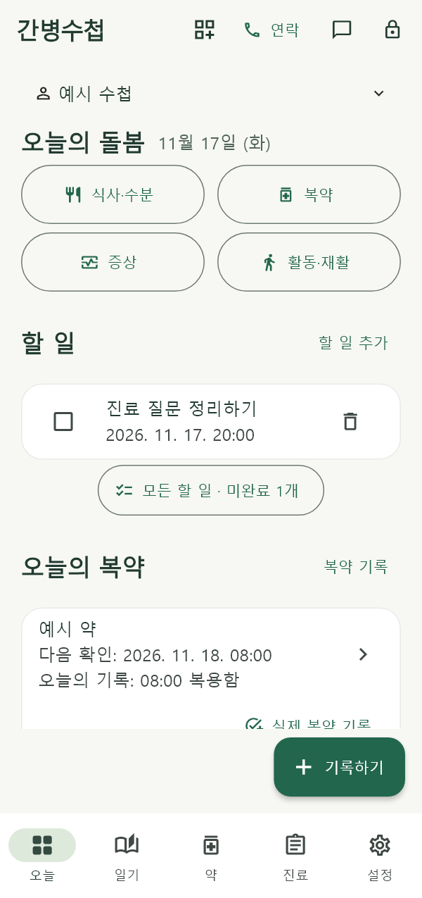
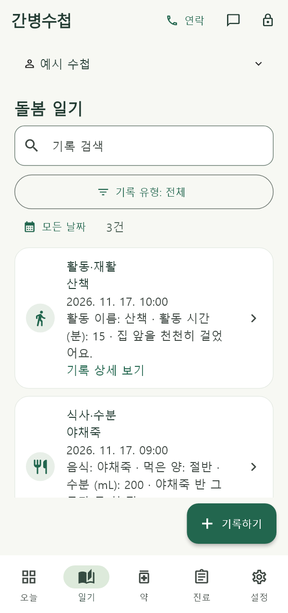
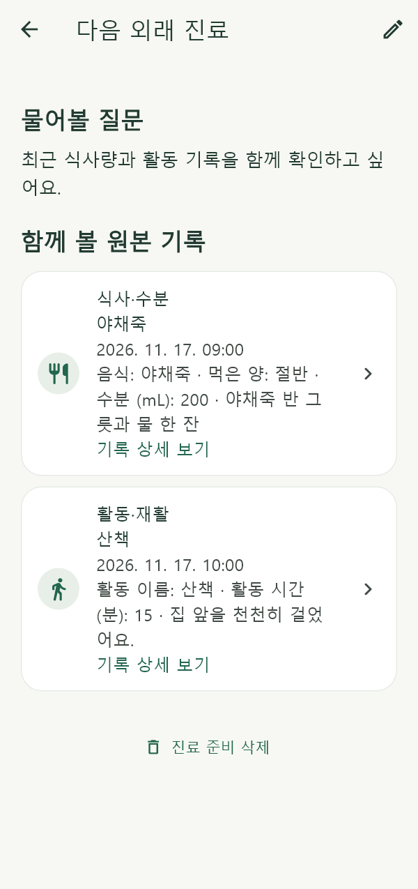

<h1 align="center">간병수첩 (Care App)</h1>

<p align="center">
  환자 본인과 가족·간병인을 위한 Android 앱입니다.<br>
  식사·복약·증상을 기록하고, 다음 진료에 가져갈 기록과 질문을 정리합니다.
</p>

<p align="center">
  <a href="./docs/mobile_current_guide.md">앱 사용 안내</a> ·
  <a href="#android에서-실행">소스로 실행하기</a> ·
  <a href="./docs/README.md">전체 문서</a> ·
  <a href="https://github.com/Chun-Jihun/care_app/issues">버그·기능 제안</a>
</p>

## 화면 미리보기

| 오늘 | 돌봄 일기 | 진료 준비 |
| :---: | :---: | :---: |
| [](./docs/screenshots/today.png) | [](./docs/screenshots/journal.png) | [](./docs/screenshots/visit.png) |

예시 수첩으로 렌더링한 앱 화면입니다.

## 주요 기능

- **간병일기**에서 식사·수분, 증상, 측정값, 활동을 수첩별로 기록하고 날짜순으로 확인합니다. 음식이나 처방자료 사진도 첨부할 수 있습니다.
- **복약 관리**에서 약 목록과 처방 이력을 관리하고 실제로 복용했는지 기록합니다. 복약 확인과 할 일에 알림을 설정할 수 있습니다.
- **진료 준비**에서 의료진에게 물어볼 질문에 관련 일기 기록을 연결합니다. 환자와 의료진의 동의를 받은 뒤 진료 내용을 녹음할 수도 있습니다.
- **간병 도우미**에 “어제 약 먹었어?”처럼 물으면 선택한 수첩에서 해당 기록을 찾아 보여 줍니다. 답변에 사용한 원본도 열어 볼 수 있습니다.
- **화면 설정**에서 큰 글자, 고대비, 큰 버튼을 선택하고 홈에 표시할 항목을 바꿀 수 있습니다. Android 홈 위젯은 오늘의 할 일과 복약 건수를 보여 줍니다.

## 기록 보관과 AI

기본 기록과 조회는 회원가입 없이 오프라인에서 사용할 수 있습니다. 기록과 사진은 기기에 암호화해 저장합니다. 원하는 범위를 암호화 파일로 내보낼 수 있으며, Google 연동을 설정한 빌드에서는 선택적으로 Google Drive에 자동 백업할 수 있습니다. [백업과 복원](./docs/mobile_current_guide.md#백업과-업데이트)

Android arm64용 모델을 별도로 설치하면 기기에서 처방전·약 봉투 사진의 글자를 읽거나 진료 녹음을 텍스트로 옮길 수 있습니다. 인식 결과는 초안으로 열리며, 원본과 대조하고 수정한 뒤 저장할 수 있습니다. [AI 기능과 모델 설치](./docs/mobile_ai_integration.md)

> 의료 질문에 대한 답변은 임상 검수가 끝날 때까지 보류합니다. 명시적인 긴급 표현이 들어오면 119 또는 의료기관 연락 안내를 우선 표시합니다.

## Android에서 실행

Flutter와 Android SDK를 설치하고, Android 기기나 에뮬레이터를 준비합니다. 저장소 루트에서 다음 명령을 실행합니다.

```sh
cd mobile
flutter pub get
flutter run
```

앱은 Android 7.0 이상에서 실행할 수 있습니다. SDK 버전, 테스트, APK 빌드와 서명 설정은 [모바일 개발 안내](./mobile/README.md#실행)에 정리돼 있습니다.

## 문서

| 찾는 내용 | 열어 볼 문서 |
| --- | --- |
| 수첩·복약·진료와 백업 사용법 | [앱 사용 안내](./docs/mobile_current_guide.md) |
| 기능 범위와 의료·개인정보 기준 | [제품 요구사항](./docs/caregiving_notebook_requirements.md) |
| 빌드·검증·배포와 데이터 구조 | [모바일 개발 안내](./mobile/README.md) |
| AI 연구, 설계 결정, 과거 검증 | [전체 문서](./docs/README.md) |

버그를 제보할 때는 사용 환경과 재현 단계를 적고, 기록이나 사진이 필요하면 예시 데이터를 사용해 주세요.
