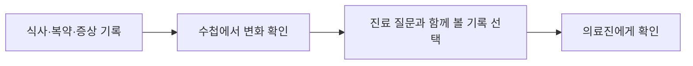

# 간병수첩 제품 요구사항

[문서 홈](README.md) · [앱 사용 안내](mobile_current_guide.md) · [안전 검증 시나리오](safety_validation.md)

간병수첩은 환자 본인과 가족·간병인이 식사, 복약, 증상과 활동을 기록하고 다음 진료를 준비하도록 돕는다. 이 문서는 제품 범위와 안전·개인정보 요건의 원본이다. 실행 방법과 현재 구현의 세부 동작은 [앱 사용 안내](mobile_current_guide.md)에서 확인한다.

[제품 범위](#제품-범위) · [기능 요구사항](#기능-요구사항) · [기록과 개인정보](#기록과-개인정보) · [AI와 의료 안전](#ai와-의료-안전) · [검증과 출시](#검증과-출시)

## 제품 범위

| 상태 | 범위 |
| --- | --- |
| Android 초기 출시 대상 | 수첩별 간병일기, 사진, 약 목록과 실제 복약, 일정, 진료 준비·녹음, 오프라인 기록 조회, 암호화 백업과 복원 |
| 선택 기능 | 기기 AI를 설치한 기록 조회 보조·OCR·음성 입력·진료 전사, 앱 잠금, Android 홈 위젯, Google 계정을 연결한 암호화 Drive 백업 |
| 검수 후 활성화 | 승인 자료에 근거한 의료 정보, 약물 상호작용 확인, 환자별 식사·활동 안내, 질환별 콘텐츠, 임상 위험 규칙 |
| 후속 지원 | iOS 기기 검증, 장기 기록·웨어러블 활용, 동의·권한·규제 검토를 거친 가족 공유와 의료기관 전송 |

회원가입 없이 수첩을 만든다. 돌봄 대상별 기록을 확인하고, 진료에서 함께 볼 원본과 질문을 고른다. 인계 및 교대·도움 요청은 복사 가능한 초안으로 제공한다. 앱의 역할은 기록과 정보 이해를 돕는 데 있다. 진단·처방·약물 변경·치료 결정은 의료진의 권한이다.

### 첫 출시 플랫폼

첫 출시와 기기 검증의 대상은 Android다. iOS는 기기와 Mac/Xcode를 확보한 뒤 빌드·서명·네이티브 기능·AI·WidgetKit을 검증한다. 공통 Flutter 구조와 기존 iOS 소스를 후속 지원에 활용한다.

후속 개발 범위

- 기록 입력·조회와 개인정보 보호를 먼저 검증한다. OCR과 음성의 사용자 확인, 진료 준비와 원본 연결, 기기별 접근성을 계속 보완한다.
- 승인된 구조화 약물 자료와 식사·위생·수면·이동·활동 안내를 검수한 뒤 연결한다. 첫 질환별 콘텐츠 팩은 암 수술·항암, 뇌졸중, 치매 중 검수자와 참여자를 확보한 영역부터 선정한다.
- 장기간 변화 분석과 질환별 진료 요약을 검토한다. 다중 기기 동기화에는 충돌을 비교하고 사용자가 선택하는 흐름을 마련한다.
- 가족 공유, 환자별 접근권한, 병원 전송, 웨어러블·병원 EMR 연동은 후속 범위다. 의료정보 공유 전 환자 동의, 수신기관·수신자 확인, 접근권한, 전송 이력·취소, 오발송 대응과 규제 검토를 갖춘다.
- 커뮤니티, 검증되지 않은 사용자 간 의학정보 추천, 모든 질환의 자동 식단 생성, 필수 회원가입 및 원격 계정 서버는 MVP 범위에서 제외한다.

## 기능 요구사항

우선순위는 제품 계획을 나타낸다. 의료 기능의 활성화에는 이 문서의 검수·안전 조건을 함께 적용한다. [화면 흐름과 유스케이스](caregiving_notebook_use_case_design.md)

### 기록과 진료 준비

| ID | 기능 | 상세 요구사항 | 우선순위 |
|---|---|---|---|
| FR-01 | 로컬 환자 맥락 | 사용자가 선택적으로 환자 프로필, 질환 범주, 치료 단계, 의료진 지시와 현재 불편을 기기 또는 승인된 내부 환경에 저장한다. 식별정보는 의료·간병기록과 분리하고 LLM에는 필요한 맥락만 제공한다. | 필수 |
| FR-03 | 간병일기 | 음식·수분·복약·증상·수면·배설·위생·피부·활동·측정·사건·연락 및 인계 내용을 시간순으로 로컬에 기록한다. 빠른 기록과 상세 기록을 구분한다. | 필수 |
| FR-08 | 처방·복약 기록과 이해 | 처방전·약 봉투 사진 또는 직접 입력으로 약을 등록하고 실제 복약을 기록한다. OCR 결과는 사용자가 확정하며, 약의 효능·목적·주의사항은 승인된 약물 데이터와 근거문서로 쉽게 설명한다. | 필수 |
| FR-09 | 식사·영양 기록과 안내 | 음식 사진, 음식명, 섭취량, 수분 및 식사 전후 상태를 기록하고 현재 상황에 맞는 검수된 식사 원칙을 제공한다. 사진 인식만으로 섭취 안전성을 확정하지 않는다. | 필수 |
| FR-10 | 진료 준비와 기록 요약 | 사용자가 입력한 질문과 로컬 간병기록의 주요 변화를 요약해 진료 시 확인할 내용을 정리한다. 요약의 원본 기록 위치를 확인할 수 있어야 한다. | 권장 |
| FR-14 | 로컬 기록 보안·관리 | 환자 프로필, 사진, 처방자료, 간병기록 및 질문·답변 기록을 암호화해 저장한다. 앱 잠금, 내보내기, 백업 선택, 대화 보관 여부와 보유기간 설정, 간병일기 반영 전 사용자 확인, 수정 이력, 개별·전체 삭제 기능을 제공한다. | 필수 |
| FR-16 | 활동·재활 기록과 안내 | 산책·운동·재활 수행과 활동 후 변화를 기록하고, 의료진 지시와 승인된 자료 범위에서 일반적인 활동 원칙과 확인할 조건을 설명한다. | 필수 |

### 간병 안내와 안전

| ID | 기능 | 상세 요구사항 | 우선순위 |
|---|---|---|---|
| FR-02 | 일상 간병 안내 | 식사, 위생, 수면, 배설, 이동, 활동 및 재활과 같은 일상 질문에 현재 기록과 승인된 근거를 바탕으로 안내한다. | 필수 |
| FR-04 | 쉬운 말·음성 지원 | 전문용어를 쉬운 말로 설명하고, 텍스트 입력이 어려운 경우 음성 질문을 지원한다. | 권장 |
| FR-06 | 근거 기반 Q&A | 승인된 의학 문서만 검색해 답변하며, 의학적 사실마다 이를 뒷받침하는 자료명, 발행기관, 발행·검수일, 페이지·절 및 원문 링크를 표시한다. | 필수 |
| FR-07 | 위험 신호 대응 | 안전 규칙을 LLM보다 먼저 적용하고 필요 시 119, 응급실 또는 담당병원 연락 기능을 제공한다. | 필수 |
| FR-11 | 설명 확인 | 사용자가 약과 주의사항을 자기 말로 다시 설명하게 하여 이해 여부를 확인한다. | 권장 |
| FR-12 | 지원서비스 | 개인식별정보를 요구하지 않고 간호·간병통합서비스, 장기요양, 치매안심센터 등 공개 정보를 안내한다. | 권장 |
| FR-13 | 보호자 지원 | 피로·수면·스트레스를 점검하고 사용자가 검토해 복사할 수 있는 가족 교대·도움 요청문과 인계메모 초안, 상담 및 지역지원 연결을 제공한다. MVP에서는 가족 초대, 수신자 관리 또는 앱 내부 전송을 제공하지 않는다. | 권장 |

### 후속 연계

| ID | 기능 | 상세 요구사항 | 우선순위 |
|---|---|---|---|
| FR-05 | 가족 협업 | 가족을 초대하고 환자정보, 담당 업무, 완료 여부 및 인계사항을 공유한다. | 최후속 |
| FR-15 | 의료기관 전달 | 환자 동의와 전송 전 확인을 거쳐 선택된 기록만 병원 또는 주치의에게 전달한다. | 최후속 |

### 간병일기에 담는 내용

빠른 기록과 상세 기록을 구분한다. 공통으로 날짜·시각, 작성자 역할 또는 별칭, 평소 대비 상태를 기록할 수 있다. 측정·상처·인지·행동 등 세부 항목은 필요한 사용자에게만 노출한다.

| 영역 | 기록 예 |
| --- | --- |
| 식사·수분 | 음식·사진, 섭취량, 식욕, 수분량, 씹기·삼키기 어려움, 식사 전후 변화 |
| 복약 | 약과 처방 안내, 예정·실제 시각, 복용 여부, 누락·거부 이유, 관찰된 반응 |
| 증상·생활 | 시작 시각·부위·정도·지속시간, 영향과 조치, 수면·배설·위생·피부 |
| 활동·측정 | 산책·재활, 이동 도움, 수행 시간과 이후 변화, 의료진 지시 또는 실제 측정값 |
| 진료·인계 | 낙상·사레 등 사건, 의료진에게 받은 안내, 경과, 질문, 다음 돌봄에 전달할 내용 |
| 간병인 상태 | 간병인 자신의 피로·수면·스트레스와 교대 필요 여부를 환자 기록과 분리 |

### 입력과 진료 준비

- 사진의 OCR 결과는 초안으로 보여 준다. 원본과 인식 텍스트를 대조하고 본문·메모를 수정할 수 있다. 확인한 내용이 편집기로 넘어간 뒤 사용자가 저장한다. 취소 시 기존 입력과 기록을 보존한다.
- 진료 녹음 전 환자와 의료진에게 목적을 설명하고 동의를 확인한다. Android에서는 화면을 켜 둔 상태로 최대 30분 동안 녹음한다. 앱 이탈·기기 잠금 시 중단하고 저장된 구간을 암호화 초안으로 보존한다. 사용자가 원본 보관·삭제를 결정한다. 전사 초안은 검토하고 저장한 뒤 진료 기록에 반영한다.
- 실제 복약의 상태는 사용자가 선택한다. 같은 약과 같은 입력 분의 기록이 있으면 중복 입력 가능성을 확인한다. 알림과 할 일 완료는 각각의 상태를 관리한다.
- 저장 실패는 저장 버튼 가까이에 표시하고 입력을 보존한다. 성공 안내는 다음 동작을 가리지 않게 한다.

## 기록과 개인정보

간병기록과 첨부 사진은 기기 또는 승인된 기관 내부 환경에 암호화해 보관한다. 기기 암호화 키는 운영체제 보안 저장소에서 보호한다. 이름과 연락처 같은 식별정보는 선택 항목으로 두고 의료·간병기록과 분리한다. 주민등록번호처럼 핵심 기능에 불필요한 식별정보는 요구하지 않는다. [개인정보 보호법 제23조](https://law.go.kr/LSW/lsLinkCommonInfo.do?chrClsCd=&lsJoLnkSeq=1020399025)

| 상황 | 적용 기준 |
| --- | --- |
| 앱 잠금 | 신규 기본값은 끔. 설정에서 6자리 PIN을 켜며 기존 잠금 선택을 보존한다. 끌 때 현재 PIN을 확인하고 기기 인증도 해제한다. 저장 암호화는 잠금 설정과 독립적으로 적용한다. |
| 재실행·앱 전환 | 잠금이 꺼져 있으면 인증 없이 수첩을 열고, 잠시 앱을 벗어났다가 돌아오면 편집 화면을 유지한다. 이탈 시 초안 저장과 임시 대화·진행 중인 AI 정리는 잠금 선택과 관계없이 적용한다. |
| AI에 제공하는 데이터 | 선택한 수첩에서 작업에 필요한 기록만 전달한다. 불필요한 식별정보는 제외하거나 마스킹한다. 질문·답변은 사용자가 선택한 보관 여부와 기간을 적용한다. |
| 외부 서비스와 로그 | 외부 LLM·광고·분석 서비스에 식별정보, 대화 원문, 원본 사진·간병기록을 전송하지 않는다. 공식 자료 조회에는 환자 맥락을 뺀 약 식별자나 일반 검색조건을 보내고 전송 항목·목적을 알린다. 대화와 기록은 외부 디버그 로그나 기본 학습 데이터에 사용하지 않는다. 운영 로그에는 오류코드, 응답시간과 비식별 안전 결과를 우선 남긴다. |
| 파일·운영체제 백업 | 사진에서 EXIF 위치정보 등 불필요한 메타데이터를 제거한다. 앱 데이터의 운영체제 자동 백업·기기 전송은 차단한다. 앱에서 보관기간, 개별·전체 삭제, 선택 내보내기와 복원을 제공한다. |
| Google Drive 백업 | 연결을 선택한 사용자가 수첩을 열면 기기 날짜 기준 하루 한 번 암호화 백업을 저장한다. 모든 수첩의 기록·약·일정·첨부 사진을 포함한다. 별도 식별정보 항목, 대화, 간병인 상태, 초안과 진료 녹음 원본은 제외한다. 원본 평문과 백업 비밀번호는 Drive에 전송하지 않는다. 기기 데이터·비밀번호와 Drive 파일의 삭제는 사용자가 각각 통제한다. |
| 캘린더 | 사용자 확인 후 날짜·시각과 일반 제목을 캘린더 작성 화면에 넘긴다. 저장 대상 계정과 최종 저장은 캘린더에서 사용자가 결정한다. |

### 화면과 접근성

- 글자 확대·굵기·고대비·큰 버튼을 제공한다. 운영체제의 큰 글자·굵은 글자·고대비·동작 줄이기를 우선한다. 핵심 작업은 2~3번의 조작으로 접근할 수 있게 하고, 일상 용어와 음성 입력 경로를 제공한다.
- 화면 애니메이션은 기본 켬이다. 앱·시스템의 동작 줄이기와 저사양 모드가 우선한다. 수첩 전환 화면에 이전 환자의 정보를 남기지 않는다. 저사양 모드는 전환·터치 효과·그림자·사진 표시 비용을 줄이며 원본 사진, 암호화, OCR 검토와 의료 안전 요건을 보존한다.
- 홈에 표시할 빠른 기록·할 일·복약·사진·간병인 상태·도우미·연락·최근 기록·합계를 선택하고 순서를 바꿀 수 있다. 빠른 기록 버튼 종류와 최근 입력 후보도 설정할 수 있다. 항목을 숨겨도 다른 진입 경로는 제공한다.
- 표시 설정은 기기에 보관하고 잠금 화면에도 적용한다. 환자 백업에 포함하지 않으며 전체 기록 삭제 뒤에도 유지한다. 기본값 복원은 기록과 보관기간을 변경하지 않는다. 안전·원본 확인·필수 오류·챗봇 진입 안내는 항상 표시한다.
- Android 홈 위젯은 선택 기능이다. 기본 요약에는 오늘의 할 일, 실제 복용함 기록 건수와 등록한 다음 확인 시각을 표시한다. 제목·약 이름은 별도 선택으로 표시한다. 환자 별칭, 자유 메모, 복용 지시·사진·저장소 키는 제외한다. 요약은 별도 키로 기기에 암호화하고 마지막 갱신 시점을 알린다. 위젯은 기존 앱 잠금을 따르며, 사용을 끄거나 전체 삭제하면 요약 캐시를 지운다. 전체 삭제는 위젯 사용·이름 표시도 해제하고 화면 설정 기본값 복원은 해당 선택을 보존한다.
- 한국어·영어·일본어·중국어 간체·번체 번역 자산을 유지한다. 설정과 잠금 화면의 언어 선택은 지원 준비까지 비활성화하고, 기존 선택과 원문 기록을 보존한다. 새 기본값은 한국어다. 119는 대한민국 번호로 표시하며 의료 안전 원칙은 언어에 관계없이 적용한다.

## AI와 의료 안전

현재 AI는 수첩 기록 조회 보조와 확인 가능한 OCR·음성 초안을 제공한다. 의료 지식 답변과 임상 규칙은 승인 자료, 구조화 규칙, 검색·답변 회귀시험을 갖춘 뒤 활성화한다. 앱의 명시적인 긴급 표현 안내는 의료기관 또는 119 연락을 먼저 돕는다. [AI 기능과 개발 안내](mobile_ai_integration.md) · [의료 활성화 설계 결정](adr/0002-medical-activation-boundary.md)

챗봇에 새로 들어갈 때는 AI 오류 가능성과 원본·근거 확인, 현재 기록 조회 범위, 의료진·약사에게 확인할 영역과 응급 연락을 안내한다. 확인 뒤 대화와 입력을 열고, 취소하면 이전 화면으로 돌아간다.

### 승인 이후의 의료 답변 흐름

1. 규칙 엔진이 고위험 표현을 먼저 처리한다. 위험 가능성이 있으면 응급기관 또는 담당 의료기관 연락을 안내한다.
2. 현재 작업에 필요한 수첩 기록만 불러오고, 허용 목록의 검수된 자료와 구조화 약물 정보를 검색한다.
3. 모델은 찾아온 근거 범위에서 쉬운 말로 설명한다. 필요한 환자 정보가 부족하거나 문서가 없거나 충돌하면 답변을 보류하고 추가 확인이나 의료진 상담으로 연결한다.
4. 의료적 핵심 주장과 출처를 대조한다. 수치·단위·조건·예외·부정 표현을 원문과 비교한다. 약물 용량, 상호작용과 위험 임계값은 검증된 구조화 자료와 규칙으로 처리한다.

답변에서 쉬운 설명, 관찰할 내용, 안전한 일상 관리, 의료진에게 연락할 조건과 담당 의료진 지시 우선 원칙을 제공한다. 모델이 정리한 내용은 원본 기록으로 돌아가 확인할 수 있어야 한다.

### 근거 자료와 인용

| 표시 영역 | 필요한 정보 |
| --- | --- |
| 내 기록 | 날짜·항목·답변 당시 버전과 사용한 내용, 원본으로 이동하는 링크. 수정·삭제된 버전을 확인할 수 없으면 발췌를 보류한다. |
| 의료 문서 | 자료명, 발행기관, 발행일 또는 개정일, 정확한 페이지·장절·표, 근거문장, 원문 링크, 앱 내부 검수일. 의학적 핵심 주장마다 연결한다. |

검색 대상은 의료진이 검수해 허용 목록에 등록한 자료로 한정한다. 국내 공공기관 자료, 전문학회·의료기관 교육자료, 최신 임상지침과 체계적 고찰을 우선하고 개별 논문은 적용 범위에 맞춰 사용한다. 자료의 대상·질환·치료 단계, 버전, 저작권·이용 범위, 검수자와 승인 이력을 기록한다. 승인·철회와 인덱스 버전 전환·롤백을 관리한다. 인터넷 검색 결과는 자동 편입하지 않는다.

검색은 키워드와 의미 검색을 함께 사용하고 대상·질환·치료 단계·최신성을 걸러낸 뒤 재정렬과 근거 적합성 검사를 수행한다. 안전 규칙과 지식베이스는 모델과 독립적으로 업데이트한다. 검색 점수·문서 조각·출처·모델 버전을 내부에서 추적할 수 있게 한다. [자료 목록과 사용 권한](model_and_rag_data_catalog.md) · [임상 검수와 승격](mfds_easy_drug_approval_workflow.md)

## 검증과 출시

기능 변경 전에 실패 시나리오와 시험을 작성한다. 앱이 오프라인이거나 AI가 중단된 상황에서도 기록·조회·사진 열람·알림·연락 기능을 사용할 수 있어야 한다. 저장소 변경 전후에 암호화 기록의 무결성, 마이그레이션, 백업·복원과 실패 시 이전 기록 보존을 검증한다. [기능별 안전 검증 시나리오](safety_validation.md) · [개발 실행과 검사](../mobile/README.md)

### 의료 검수와 모델 평가

제공된 근거에서 확인할 수 없는 주장, 출처 연결 누락, 위험 신호 누락, 무단 외부 전송, 허용 범위 밖의 진단·처방·치료 권고는 각각 출시 평가에서 **0건**이어야 한다. 임상 검수자가 확보될 때까지 의료 답변과 임상 판단의 활성화를 보류한다. 자동 채점·합성 사례·모델 간 합의는 개발 진단으로 사용한다.

모델은 사실성, 근거 충실도, 위험 회피, 보류의 적절성, 핵심 주장별 출처 추적을 먼저 검증한다. 안전 기준을 통과한 후보 사이에서 한국어 표현, 반복 일관성, 도구 호출 정확도, 지연시간, 메모리와 배터리를 비교한다. 검색기와 답변 모델은 각각 평가하고, 모델·임베딩·인덱스·프롬프트를 바꿀 때 의료 회귀시험을 실시한다. [실험의 평가 한계](no_human_review_development_plan.md) · [평가 방법](slm_rag_validation_plan.md)

### MVP 성공지표

| 평가 대상 | 기준 |
| --- | --- |
| 근거 검색·인용 | 필요한 승인 문서의 상위 검색 포함률 95% 이상. 근거 충실도 통과 주장 중 정확한 위치와 문장 연결률 95% 이상, 고위험 주장은 100%. |
| 보류와 안전 | 근거가 없거나 충돌하는 요청의 올바른 보류·확인 연결률 95% 이상. 의료 안전 실패에는 위의 0건 기준 적용. |
| OCR·음성 입력 | 자료 유형과 필드별 정확도·수정률을 평가한다. 처방·사진 추출의 사용자 확인은 100% 기준. 정확도 수치 목표는 대표 자료 파일럿 뒤 확정한다. |
| 기록과 진료 준비 | 핵심 업무 완료율 90% 이상. 기록·정보 탐색과 진료 준비 시간의 개선 목표는 동일 과업 사용자 파일럿 뒤 확정한다. |
| 데이터 무결성과 보호 | 기록 소실·환자 간 혼합·승인되지 않은 네트워크 전송 0건. 앱 시작부터 저장·AI·오류·내보내기·업데이트까지 확인한다. |

가족간병인 12~20명과 간호사 3~5명, 의사·약사·영양사 각 1~2명이 참여하는 조사를 제안한다. 주·보조 간병인, 젊은 자녀와 중·고령 배우자를 포함해 기록 입력, 복약 확인, 진료 준비와 개인정보 통제에 필요한 시간을 살핀다. 세부 과업과 USP별 산식은 [사용자 조사와 제품 전략](competitive_landscape_and_product_strategy.md#11-제품-usp와-검증-kpi)에 둔다.

개별 환자의 치료 추천으로 범위를 확장할 경우 기능·출력·위험도를 문서화하고 디지털의료기기 적용 가능성을 검토한다. [식약처 허가·심사 가이드라인](https://www.mfds.go.kr/brd/m_1060/view.do?company_cd=&company_nm=&itm_seq_1=0&multi_itm_seq=0&page=1&seq=15628)
