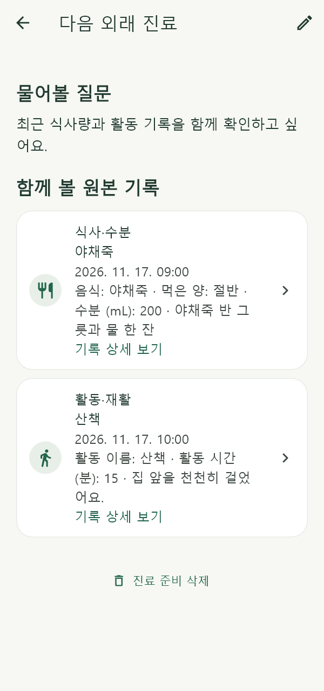

# 간병수첩 사용 안내

[문서 홈](README.md) · [화면 미리보기](../README.md#화면-미리보기) · [Android 앱 빌드](../mobile/README.md#실행)

Android에서 수첩을 만들고, 하루 기록을 남기고, 다음 진료에 볼 내용을 모으는 방법을 안내합니다. 기본 기록과 조회는 계정과 모델 설치 없이 오프라인에서 사용할 수 있습니다.

[수첩 시작](#수첩-시작) · [복약과 할 일](#복약과-할-일) · [진료 준비](#진료-준비) · [기록 조회와 AI](#기록-조회와-ai) · [백업과 복원](#백업과-업데이트)

## 수첩 시작

1. **내 수첩 시작하기**를 누릅니다. 수첩을 구분할 별칭과 돌봄 역할을 선택할 수 있습니다.
2. **오늘**에서 자주 쓰는 기록 항목을 누르거나 **기록하기**에서 유형을 고릅니다. 날짜와 필요한 항목을 입력하고 저장합니다.
3. **일기**에서 날짜·유형·검색어로 기록을 찾습니다. 기록 상세에서 원문과 첨부한 사진을 열고 내용을 수정할 수 있습니다. 돌봄 대상이 여럿이면 화면 상단에서 수첩을 바꿉니다.

저장 전 입력은 보관을 선택한 경우 **작성 중인 초안**에서 이어 쓸 수 있습니다. 초안 보관기간은 7일, 30일, 직접 삭제할 때까지 중에서 고릅니다. 기기가 자동 저장 전에 앱을 즉시 종료하면 마지막 입력 일부가 남지 않을 수 있습니다.

수첩을 잠그려면 **설정**에서 6자리 잠금 번호를 켭니다. 기기 인증은 지원되는 휴대전화에서 추가로 선택할 수 있습니다. 기록과 사진은 잠금 선택과 관계없이 기기에 암호화해 저장됩니다.

## 복약과 할 일

- **약**에서 처방받은 약, 의료진의 복용 안내와 확인할 시각을 기록합니다. 처방 안내를 바꿔도 이전 기록에는 당시 안내가 남습니다.
- 실제 복용을 확인한 뒤 **복약 기록**에 복용함·누락·거부·모름 중 해당 상태를 선택합니다. 같은 약을 같은 분에 기록했다면 추가 전에 다시 확인할 수 있습니다.
- **오늘 → 할 일 추가**에서 예정 시각과 알림을 설정합니다. 알림은 기기의 권한과 절전 상태에 따라 늦게 도착할 수 있습니다.
- 이미 저장한 할 일의 편집 화면에서 **캘린더에 추가**를 누르면 날짜·시각과 일반 제목이 작성 화면에 채워집니다. Google 캘린더를 쓰려면 캘린더에서 계정을 선택하고 저장합니다.

## 진료 준비

**진료** 탭에서 의료진에게 물어볼 질문을 적고, 함께 볼 일기 기록을 골라 연결합니다. 연결한 기록이 바뀌면 다시 확인할 수 있도록 표시합니다.

1. **진료 → 진료 녹음**으로 들어갑니다. 환자와 의료진에게 녹음 목적을 설명하고 동의를 확인한 뒤 시작합니다.
2. 화면을 켜 둔 상태에서 최대 30분까지 녹음합니다. 앱을 벗어나거나 휴대전화를 잠그면 녹음이 멈추고 이미 저장된 구간이 암호화 초안으로 남습니다.
3. 녹음을 들어 보고 원본을 보관하거나 삭제합니다. 기기 모델을 설치했다면 **전사하고 검토하기**로 텍스트 초안을 만들 수 있습니다. 긴 전사문은 시간 구간별 초안으로 나뉘며, 검토하고 저장한 부분이 진료·연락 기록에 들어갑니다.

질문과 원본 기록을 연결한 예시 보기

## 기록 조회와 AI

| 하고 싶은 일 | 앱에서 찾는 위치 |
| --- | --- |
| “어제 약 먹었어?”처럼 물어보기 | 상단 말풍선의 **간병 도우미**. 조회는 선택한 수첩에 적용됩니다. |
| 답변에 사용한 기록 확인하기 | 답변 옆 **근거 보기**에서 시각·항목과 원본을 확인합니다. 변경되거나 삭제된 기록은 답변 당시 버전과 구분합니다. |
| 사진 속 글자를 옮기기 | 사진 옆 **글자 읽기**. 원본과 결과를 비교해 본문·메모를 고치고, 편집기에 반영한 뒤 저장합니다. |
| 음성으로 입력하기 | 지원 입력란의 **마이크**. 일반 음성 입력은 30초까지이며, 진료 녹음은 진료 탭에서 따로 진행합니다. |

글자 읽기·음성 입력·진료 전사에는 Android arm64에서 기기 모델 설치가 필요합니다. 글자 읽기용 사진은 최대 1,600만 화소입니다. [모델 설치와 사용 범위](mobile_ai_integration.md#설치와-사용)

> [!NOTE]
> 현재 도우미는 기록 조회를 지원합니다. 의료 질문의 답변은 검수된 근거를 준비할 때까지 보류합니다. 명시적인 긴급 표현에는 119 또는 의료기관 연락 안내가 먼저 표시됩니다.

대화 보관과 조회 범위

- 처음 사용할 때 대화를 이번 앱 사용 동안, 7일, 30일 또는 직접 삭제할 때까지 중 선택합니다. 임시 대화는 앱 이탈이나 잠금 시 정리되고, 보관 대화는 정한 기간을 적용합니다.
- 날짜와 기간은 지원하는 한국어 표현으로 지정할 수 있습니다. 최근 결과 8개와 조회 조건을 표시하고 전체 결과는 50개씩 열 수 있습니다. 약명·용량 표기는 입력과 일치해야 하며 모호한 조건은 앱이 다시 확인할 수 있습니다.
- **이전 질문 더 보기**로 대화 목록을 50개씩 늘립니다. 화면의 표시 개수와 사용자가 정한 보관기간은 따로 적용됩니다.

## 화면·접근성 설정

**설정 → 화면·접근성 설정**에서 큰 글자, 굵은 글자, 고대비, 큰 버튼, 애니메이션, 동작 줄이기와 사진 미리보기를 조정합니다. 운영체제의 접근성 설정을 함께 적용합니다. 저사양 모드는 전환·그림자·사진 표시 효과를 줄입니다.

- **홈 화면 편집**에서 표시할 항목과 순서를 바꿉니다. **위로**·**아래로** 버튼으로 위치를 옮길 수 있습니다. 숨긴 항목은 하단 탭이나 **기록하기**에서도 열 수 있습니다.
- 최근 음식·활동 이름은 후보를 눌렀을 때 입력됩니다. 복용 상태·관찰 결과·과거 시각은 새 기록에서 직접 선택합니다.
- 화면 설정은 잠금 화면에도 적용되며 기기에 보관합니다. **화면 설정 기본값으로**는 글자·효과·홈 구성을 되돌립니다.
- 기본 표시 언어는 한국어입니다. 언어 선택 메뉴는 지원 준비가 끝날 때까지 비활성화되며, 이전에 저장한 선택은 유지합니다.

### 휴대전화 홈 위젯

**설정 → 휴대전화 홈 위젯**에서 요약을 켜고 **홈에 위젯 추가 요청**을 누릅니다. 추가 창이 없는 런처에서는 홈의 빈 곳을 길게 눌러 위젯 목록에서 간병수첩을 선택합니다.

위젯은 선택한 수첩의 할 일·실제 복약 건수와 다음 확인 시각을 마지막 갱신 시점 기준으로 표시합니다. 할 일 제목과 약 이름은 별도 옵션으로 켭니다. 이름과 제목에 직접 적은 내용은 홈 화면에서도 읽을 수 있습니다. 앱을 열거나 기록·수첩을 바꾸면 요약이 갱신되고, 날짜나 시간대가 바뀌면 위젯에서 갱신을 안내할 수 있습니다. 정시 알림은 앱의 알림 기능에서 관리합니다.

## 백업과 업데이트

**설정 → 백업과 복원**에서 내보낼 파일을 만들거나 저장해 둔 백업을 엽니다.

| 방법 | 사용 방법과 범위 |
| --- | --- |
| 파일로 백업 | 수첩과 기간을 고르고 사진·보관 대화·간병인 상태·별칭과 연락처의 포함 여부를 정합니다. 약 목록과 처방 이력은 기간과 무관하게 포함됩니다. |
| Google Drive 자동 백업 | 메뉴가 제공되는 Android 빌드에서 계정을 연결한 뒤 사용합니다. 수첩을 열 때 하루 한 번 모든 수첩의 기록·약·일정·첨부 사진을 암호화해 갱신합니다. **지금 백업**은 당일 변경을 바로 반영하고 **마지막 성공**은 실제 업로드 완료 시각을 표시합니다. |

두 방법 모두 12자 이상의 백업 비밀번호를 사용합니다. 작성 중인 초안과 진료 녹음 원본은 백업 범위에서 제외됩니다. Drive 자동 백업에는 별도 식별정보 항목·대화·간병인 상태도 포함되지 않습니다.

### 백업 복원

1. **백업과 복원**에서 파일을 선택하거나 **Google Drive에서 복원**을 엽니다. Drive에서는 백업을 만든 Google 계정으로 연결합니다.
2. 백업 비밀번호를 입력하고 **비밀번호 확인과 내용 보기**를 눌러 날짜와 포함된 기록을 확인합니다.
3. **수첩 추가 복원**을 눌러 별도 수첩으로 추가합니다. 이미 복원한 백업의 중복 추가는 차단됩니다. 복원된 일정·약 알림은 검토한 뒤 설정에서 켭니다.

> [!IMPORTANT]
> 복원에는 백업을 만들 때 정한 비밀번호가 필요합니다. Google 계정으로도 잊은 비밀번호를 복구할 수 없습니다. Drive 연결을 해제하거나 휴대전화의 기록을 모두 지워도 Drive의 파일은 남습니다. Drive 설정의 앱 관리에서 해당 앱 데이터를 삭제할 수 있습니다.

저장 공간과 이전 버전

- 복원에는 백업 파일 외에도 기존 암호화 DB와 사진을 잠시 복사할 공간이 필요합니다. 녹음 등을 지운 뒤 **앱 저장 공간 정리**에서 비워진 DB 공간을 돌려받을 수 있습니다. 정리 중에는 새 암호화 파일을 만들 임시 공간이 필요합니다.
- 처리 중에는 **기록 보기**에서 기존 기록을 열거나 의료기관과 119 연락 기능을 사용할 수 있습니다. 편집은 처리가 끝난 뒤 다시 열립니다. 복원을 적용하는 순간에는 잠시 진행 안내를 표시하고, 완료 후 새 상태의 홈을 엽니다.
- 이전 전체 백업은 수첩을 교체하는 형식이므로 추가 확인이 필요합니다. 현재 기기나 백업에 진료 녹음 원본이 있으면 전체 교체가 차단됩니다.
- 앱 서명이 바뀌는 업데이트를 하기 전에는 별도 암호화 백업을 보관하고 비밀번호를 확인합니다. [백업 형식과 앱 업데이트](../mobile/README.md#저장소와-백업-형식)

