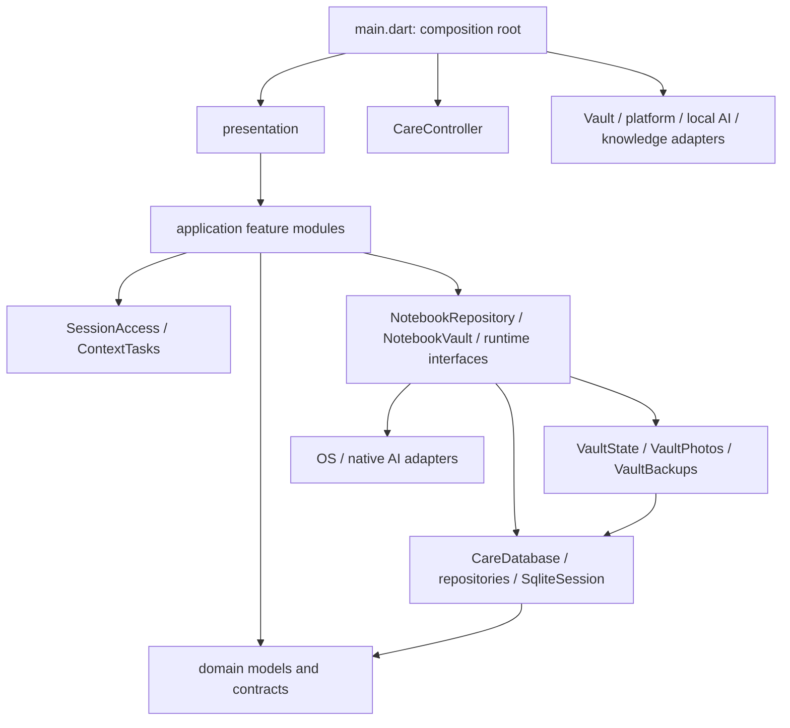

# care_app 전체 품질 감사 및 개선 계획 — 2026-11-03

- 대상: 기존 `care_app` 프로젝트의 현재 작업 트리
- 기준 커밋: `754ff69b6b566f6d2c6a57195339abbdfd6f28f0`
- 제품 요구사항 원본: [caregiving_notebook_requirements.md](caregiving_notebook_requirements.md)
- 범위: 현황·문서·아키텍처·코드·테스트·요구사항 대응과 개선 계획
- 변경 정책: 기존 소스·문서·사용자 변경을 수정하지 않았다. 새로 작성한 이 보고서와 Git에서 제외되는 감사용 로그·합성 재현 자료만 추가했다. 실제 수정은 사용자 승인 이후의 별도 작업이다.
- 성격: 개발 품질 감사다. 임상적 정확성, 이용 권리, 스토어 심사 적합성 또는 모든 보안 취약점의 부재를 인증하는 결과가 아니다.

## 1. 현황과 결론

프로젝트는 초기 골격 단계가 아니다. Flutter 기반의 로컬 간병수첩, 암호화 저장·사진·복약·할 일·진료 준비·초안·선택 백업, Android용 선택 설치형 로컬 AI 입력과 제한된 기록 조회가 구현되어 있다. Python 코드는 별도의 수집·변환·학습·평가 개발 트랙을 담당한다.

현재 구조를 전면 교체할 근거는 발견하지 못했다. 환자 범위와 세션을 관리하는 `SessionAccess`, 짧은 SQL 트랜잭션, 암호화 세대 교체, DB와 독립된 백업 문서 계약은 유지할 가치가 있다. 먼저 특정 상태 전이와 작은 계약 불일치를 고치는 편이 안전하다.

다만 기존 시험이 모두 통과해도 놓치는 동작이 있다. 이번 감사에서 다음을 확인했다.

| 분류 | 결과 |
|---|---|
| High 확정 결함 | F-01: 앱 잠금 활성화와 백그라운드 전환이 겹치면 PIN은 켜졌지만 잠기지 않은 상태가 남음 |
| Medium 확정 결함 | F-02: 백업 확인의 처방 이력 개수 오표시; F-03: 패키지 생성 중 실패 후 불완전 게시와 재시도 차단; F-04: 기본 Python 시험의 미추적 로컬 자료 의존; F-05: 현재 사용 안내와 구현 버전의 불일치 |
| 개선 권장 | R-01: 재현 가능한 자동 검증; R-02: 긴 저장 작업 중 화면 응답성; R-03: 도메인 용어·설계 결정의 문서 연결 |
| 미검증 의심 | U-01: 취소 후 네이티브 연산의 가용성; U-02: 시간대 변경 시 표시 정책; U-03: 극단적인 백업·모델 메모리 사용 |
| Critical | 이번 범위에서 확인된 Critical 결함 없음. 검증하지 못한 영역까지 안전하다는 의미는 아님 |

의료 답변의 승인 목록이 비어 있고 iOS AI가 비활성인 상태는 명시된 개발·출시 제한이다. 이를 임의로 풀어야 하는 버그로 분류하지 않았다. 전체 제품의 의료 기능까지 완료되었다고 판단할 수도 없다.

## 2. 조사·변경 보존 범위

### 2.1 Git 기준과 기존 사용자 변경

시작 시 변경사항은 `AGENTS.md` 수정과 `docs/agents/`의 새 설정 문서 3개였다. 해당 내용은 그대로 보존했다. 커밋·푸시·브랜치 변경·추적 해제·Git 이력 정리·원격 이슈 작성은 수행하지 않았다.

추적 파일 518개와 기존 설정 문서 3개에 대해 시작 시 내용 해시를 기록했다. 검증 종료 시 기존 521개 파일의 해시가 유지되고 삭제된 파일이 없는 것을 확인한다. 빌드·시험 도구가 사용하는 `mobile/build/`, `.dart_tool/`, `.tools/`의 캐시·산출물은 원본 소스와 구분한다.

`git status`는 다음 두 실험 결과 디렉터리에 접근 거부를 보고했다. 이 경고를 저장소 변경이나 파일 부재로 해석하지 않았다.

- `experiments/agent_eval/results/automated_agent_evaluation_v1/`
- `experiments/agent_eval/results/model_comparison_v1/`

### 2.2 조사 수준

| 대상 | 확인한 범위 | 한계 |
|---|---|---|
| 추적 파일 518개 | 목록·크기·내용 해시, 파일 형식, 관련 설정·메타데이터 분류 | 모든 줄의 수동 의미 검토나 모든 바이너리의 실행 검증은 아님 |
| 문서 46개 | 루트 README·AGENTS, `docs/**/*.md`, 모바일 README의 제목·상태·참조와 핵심 내용 대조 | 역사적 연구 문서는 구조·상태·관련 주장 중심; 인용한 외부 논문·웹페이지의 최신 사실을 다시 검증하지 않음 |
| `mobile/lib/` Dart 127개 | import/export 관계 스캔과 주요 실행·저장·안전 경로 수동 검토 | 생성 번역 자료는 카탈로그 검사; 모든 화면의 실제 OS 동작을 재실행한 것은 아님 |
| `mobile/test/` 추적 파일 52개 | 지원 코드·fixture 포함 구성 확인, 기존 모바일 시험 199개 실행 | 네이티브 어댑터의 상당 부분은 fake로 대체됨 |
| Python 110개 | `scripts/` 87개 Python 및 `tests/` 23개 Python의 구문 검사, import 관계, 핵심 경로 검토·기존 시험 실행 | 학습·모델 재추론·전체 대용량 원천 재수집은 실행하지 않음 |
| 추적 JSON 57개 | 파싱, 평가·의료 승인 상태와 manifest 구분 | 모든 모델 가중치의 전체 해시를 다시 계산한 것은 아님 |
| 의료 기본 패키지 | 문서 13종·30페이지, 약물 출처 11개에 대한 기존 감사 도구 실행 | 원문 해시·구조·텍스트 검사는 임상 검수와 다름 |
| Android | Gradle 설정·manifest·네이티브 진입점, 캐시 기반 debug 오프라인 빌드 | 새 기기 설치·권한·배터리·OS 종료 시험은 하지 않음 |
| iOS | Swift·plist·entitlements와 비활성 AI 경로 정적 확인 | Windows 환경이며 Mac/Xcode 빌드와 실행은 미검증 |

`.env` 값, 사용자 수첩·실제 환자 사진·녹음·기기 자료는 읽지 않았다. `.env.example` 등 추적 텍스트의 자격정보 패턴 검사에서는 후보가 없었으며, 추적 중인 `.env`·서명 비밀 파일도 없었다. 이번에 Git 전체 과거 객체, 원격 PR·Issue 첨부, 외부 취약점 DB까지 조사하지는 않았다.

### 2.3 제외하거나 확인하지 못한 대상

- `data/`, `models/`: 디렉터리·선별 manifest·필요한 로컬 패키지만 확인. 원천 전체와 가중치 전체를 읽지 않음.
- `MedAgentBench/`: 외부 benchmark 체크아웃으로 분류. 제품 코드처럼 내부 구현 전체를 감사하지 않음.
- 위의 접근 거부 디렉터리와 Python 시험이 요구하는 일부 로컬 실험 파일: 권한 제약 밖 재실행에서도 접근하지 못함.
- 다운로드한 PDF·HTML 원문 전체의 의료 내용·표 해석·라이선스·대상 환자 적합성: 전문 검수 미수행. 패키지 출처와 해시만 확인.
- 접근 거부 대상에 향하는 문서 링크 13곳: 미존재로 단정하지 않음. 코드 블록을 제외하고 접근 가능한 대상을 검사한 범위에서는 확인된 누락 링크가 없었음.

## 3. 디렉터리·기술·실행 구조

### 3.1 주요 디렉터리

```text
care_app/
├── AGENTS.md / README.md       프로젝트 원칙·현재 상태 안내
├── docs/                      요구사항·설계·안전 계획·당시 검증 기록
│   ├── agents/                스킬이 읽는 이슈·라벨·도메인 규칙
│   └── 의료 PDF·HTML          로컬 원문; Git 제외
├── mobile/
│   ├── lib/domain/            기록·초안·대화·근거·오류 모델
│   ├── lib/application/       세션·기능 명령·기록 조회·안전 정책
│   ├── lib/infrastructure/    SQLCipher·Vault·플랫폼·AI·지식 패키지
│   ├── lib/presentation/      화면·편집기·입력 검토·접근성
│   ├── lib/l10n/              5개 언어 카탈로그와 표시 문구
│   ├── packages/care_ort/     제한된 FP32 ONNX FFI adapter
│   ├── android/ / ios/        OS 설정·호출 연결
│   ├── test/ / tool/          회귀 시험·별도 실행 probe
│   └── assets/               신뢰 manifest·라이선스·개발 지식 descriptor
├── scripts/                   수집·압축·학습·모델 변환·평가 도구
├── tests/                     Python 계약·보안·패키지·평가 시험
├── experiments/               고정 프로필·해시·개발 평가 산출물
├── data/ / models/ / .tools/   원천·가중치·SDK·캐시; 대부분 Git 제외
└── MedAgentBench/              별도 외부 benchmark 자료
```

추적 파일 분포: `mobile/` 291개, `scripts/` 89개, `tests/` 24개, `experiments/` 69개, `docs/` 41개, 루트 4개. 여기에는 생성물·자산·설정도 포함한다. `docs/agents/` 3개는 시작 시 미추적 상태였다.

### 3.2 기술 스택

| 영역 | 확인한 구성 |
|---|---|
| 모바일 | 로컬 SDK Flutter 3.47.2 / Dart 3.13.2; Material 3; `ChangeNotifier`·기능별 조회 캐시 |
| 데이터 | `sqlite3` SQLCipher, 서로 다른 키의 간병·식별 DB, AES-256-GCM 사진·백업, PBKDF2, OS 보안 키 저장소 |
| OS 기능 | `local_auth`, `flutter_local_notifications`, `image_picker`, `file_picker`, `record`, `timezone` |
| Android | compile SDK 37, 최소 API 24; AGP 9.3.2, Kotlin 2.4.0, Gradle 9.5.0; 실행 스크립트의 JDK 21 |
| iOS | 공통 Flutter 화면·Swift 플랫폼 연결; 기본 기능 실행과 네이티브 AI 연결은 Mac 검증 필요 |
| 로컬 AI 개발 구성 | Qwen3.5-2B SFT/Q4_K_M + llama.cpp; PP-OCRv5/ONNX; Whisper small LoRA/INT8 + sherpa; Silero VAD |
| 데이터·실험 도구 | Python CLI, SQLite·JSON·zlib; 모델 작업별 별도 환경·manifest·고정 프로필 |
| 이번 Python 시험 | `C:\Users\wjswl\miniconda3\python.exe`, Python 3.14.6. 과거 모델 실행의 Python 3.12 프로필과 별개 |

### 3.3 현재 module 의존관계



domain의 import 스캔에서는 Flutter·SQLite·application·infrastructure 의존을 찾지 못했다. presentation의 직접 저장소 접근 금지는 구조 시험으로 보호한다. 일부 forwarding module이 있다는 이유만으로 전부 제거하는 것은 권장하지 않는다. 삭제했을 때 환자 범위·캐시·직렬화·호환성 지식이 caller로 퍼지는지 판단해야 한다.

### 3.4 주요 데이터 흐름

**직접 입력·초안·사진:** 편집기 → typed `DraftPayload`/`DraftSession` → 선택 보관 정책으로 암호화 초안 → 사용자 저장 → 짧은 SQL 트랜잭션으로 기록 확정과 초안 삭제. 사진은 검증·정규화·메타데이터 제거·별도 키 암호화 후 DB 연결과 함께 확정한다. 실패 시 초안·이전 기록을 보존한다.

**백업:** 선택 범위 → 고정 `BackupDocument` 투영 → 선택 사진과 키 수집 → 비밀번호 암호화 → 사용자 파일 저장. 복원은 내용·참조·암호화를 검증하고 새 암호화 세대에서 ID를 다시 연결한 뒤 commit marker로 전환한다. 기존 수첩에 무조건 덮어쓰는 구조가 아니다.

**질문:** 위험·다른 수첩 요청 정책 → 자연어 조건 parser 또는 제한된 모델 조건 추출 → 호스트의 환자 범위 내 실제 기록 조회 → ID·버전 출처와 원문 표시. 모델이 자유롭게 만든 의학 설명을 그대로 표시하지 않는다.

**의료 근거:** 수집 원문 → 미검수 로컬 snapshot → 해시·범위가 고정된 경량 package → 개발용 열람. 운영 의료 답변은 별도의 임상 허용 목록을 요구한다. `main.dart:34`의 검수 규칙은 빈 목록이고, `device_knowledge_library.dart:28`의 운영 배포 목록도 비어 있다.

**OCR·음성:** 로컬 추론 → 원본 대조·편집 가능한 미확정 텍스트 → 사용자 반영 → 기록 편집기에서 사용자 저장. 자동 확정과 임상 정확도 보장을 제공하지 않는다.

## 4. 정상 설계와 보존할 부분

1. **환자·세션 제어의 locality.** `SessionAccess`와 epoch 검사를 없애면 잠금·수첩 전환·지연 결과 확인이 여러 caller로 퍼진다. 실제 depth가 있는 module이다. F-01도 이 interface의 상태 전이를 보완하는 방향이 맞다.
2. **Vault의 depth.** caller는 키 파일 배치·암호화 세대·commit marker·실패 복원·wipe 재개를 직접 알 필요가 없다. facade의 메서드 수나 줄 수만 보고 얕다고 판단할 수 없다.
3. **백업 문서 계약의 독립성.** DB schema v6과 백업 document version 5를 분리하고 옛 합성 fixture를 유지한다. 호환성에 필요한 명시적 투영·중복을 무조건 제거하면 안 된다.
4. **실제 SQLCipher 시험.** 데이터 재개방·환자 분리·변경 이력·마이그레이션·disk-full 롤백·사진 암호화·추가 복원을 실제 파일 기반으로 검사한다. 단순 mock 성공만으로 저장 안전을 주장하지 않는다.
5. **기록 조회의 상한과 정렬.** 날짜·환자 범위, 동일 시각의 ID 정렬, 제한 조회·묶음 조회·캐시 무효화가 구현되어 있다. 12,000건 합성 장기 사용 시험을 포함한다.
6. **의료 승인과 해시 검증의 구분.** manifest 일치만으로 임상 승인하지 않는다. 현재 운영 허용 목록을 비워 두고 미검수·불완전·충돌 결과를 보류하는 경로가 있다.
7. **사용자 통제.** 앱 잠금 기본 꺼짐, 선택적 식별정보, 대화·초안 보관 정책, OCR 검토·최종 저장, 언어 메뉴의 의도적 비활성화가 요구사항과 연결되어 있다.
8. **실험의 비출시 해석.** 읽은 manifest·요약에서 `medical_release_gate_result=false`, `evaluation_eligible=false` 등 개발 진단 표시를 유지한다. 합성 평가 결과를 임상 성능으로 취급하지 않는다.
9. **Python 호환 진입점.** `ds_agent_model_runner.py` 등의 재공개는 기존 caller·시험 호환을 보존한다. 재공개된 private 이름을 단순 미사용 코드로 보고 삭제하지 않는다.

## 5. 확인한 결함

중요도는 이번 프로젝트의 사용자 영향·발생 조건·복구 가능성을 기준으로 정했다. 검증 범위 밖의 실제 발생 빈도나 공격 가능성까지 측정한 등급은 아니다.

### F-01 · High · 앱 잠금 활성화와 백그라운드 전환의 경쟁 상태

- **분류:** 실행으로 확인한 결함. 실제 OS의 전환 타이밍·발생 빈도는 미검증.
- **근거:** [care_controller.dart](../mobile/lib/application/care_controller.dart#L270) 270·278·306행, [app.dart](../mobile/lib/presentation/app.dart#L44) 44행, [local_credentials.dart](../mobile/lib/infrastructure/local_credentials.dart).
- **조건:** 잠금 없는 수첩에서 PIN 활성화가 자격정보 해시·저장을 기다리는 동안 앱이 백그라운드로 전환된다.
- **관찰:** `setPin()` 완료 후 `hasPin == true`인데 `unlocked == true`다. `handleBackground()`는 아직 false인 `_hasPin`을 보고 잠금 없는 경로를 선택해 기존 epoch를 유지한다. resume 경로는 열린 수첩을 갱신하며 잠금 여부를 다시 강제하지 않는다. 이후 한 번 더 백그라운드 전환하면 정상 잠금된다.
- **공개 interface 재현:** 잠금 없이 시작 → `final pending = c.setPin(합성 6자리 PIN)` → `c.handleBackground()` → `await pending` → PIN 활성·잠금 해제 상태를 확인.
- **영향:** 사용자가 앱 잠금을 켠 뒤 첫 앱 전환에서 기대한 인증 경계가 적용되지 않을 수 있다. 암호화 저장이 해제되거나 기존 PIN 사용자의 일반 잠금이 전부 우회된다는 뜻은 아니다.
- **권장:** 인증 활성화·백그라운드 전이를 함께 표현하고, 진행 중 활성화가 이전 foreground 세션을 계속 열어 두지 못하도록 한다. 모든 작업 epoch를 무조건 무효화해 잠금 없는 편집기 유지 요구를 깨뜨리는 수정은 피한다.
- **변경 위험:** PIN은 저장됐지만 화면 상태가 맞지 않는 실패, 초안 유실, 기기 인증·파일 선택 복귀 오작동. 활성화 완료 전/후·secret 쓰기 실패·실제 pause/resume·기존 잠금 유지 조합을 회귀시험해야 한다.
- **재현 근거:** 임시 `audit_probe_test.dart`의 첫 시험. 기존 `optional_lock_test.dart`는 정상 활성화·비활성화와 비활성화 중 잠금 등을 검사하지만 이 순서는 놓친다.

### F-02 · Medium · 백업 확인의 처방 이력 개수는 항상 0

- **분류:** 실행으로 확인한 표시 결함.
- **근거:** [backup_page.dart](../mobile/lib/presentation/backup_page.dart#L11) 11·16행, [backup_document.dart](../mobile/lib/infrastructure/backup_document.dart#L109) 109행, [backup.dart](../mobile/lib/domain/backup.dart).
- **원인:** `Map<BackupCategory,int>`에 `'medication_plan'` 문자열을 넣어 조회한다. enum 계약에는 처방 이력 category가 없어 `null ?? 0`으로 표시된다.
- **재현:** 약을 등록한 뒤 처방 지시를 한 번 변경하여 plan 2개를 만든다. 실제 선택 백업 rows의 `medication_plan`은 2개지만 `backupCounts()`는 `처방 이력 0개`를 반환한다.
- **영향:** 사용자가 백업 범위를 잘못 이해한다. 이번 재현에서 실제 처방 이력 누락이나 복원 손실은 발견하지 않았다.
- **권장:** 요약 category·count·표시 문구를 같은 typed vocabulary로 연결한다. 처방 이력 수를 제공할지, 실제 count가 없는 항목 표시를 제거할지 명확히 선택한다. frozen 백업 필드를 live SQL에서 자동 생성하는 변경은 필요하지 않다.
- **변경 위험:** 기존 archive version을 불필요하게 바꾸거나 모든 번역·미리보기 경로의 수가 달라질 수 있다. 기존 백업·복원과 실제 plan이 있는 UI를 함께 검사한다.
- **재현 근거:** 임시 `audit_probe_test.dart`의 두 번째 시험. 기존 archive 보존 시험이 있어도 화면의 잘못된 count까지 보장하지는 않는다.

### F-03 · Medium · 패키지 게시 실패 후 불완전 결과가 남고 재시도가 차단됨

- **분류:** 두 실제 생성 함수를 합성 파일·예외 주입으로 실행해 확인한 개발 도구 결함.
- **근거:** [package_mobile_ai.py](../scripts/package_mobile_ai.py#L36) 36~41행의 final-name 직접 쓰기, [build_knowledge_delivery.py](../scripts/build_knowledge_delivery.py#L74) 74·78행의 pack rename 후 descriptor 쓰기.
- **재현 A:** AI pack의 첫 복사에서 `OSError`를 발생시키면 최종 이름의 불완전 `.careai`가 남고 앱 manifest는 생성되지 않는다. 같은 경로 재실행은 `FileExistsError`로 끝난다.
- **재현 B:** knowledge pack을 완성한 뒤 descriptor 쓰기를 실패시키면 pack만 존재한다. 같은 출력 경로에서 재실행하면 역시 `FileExistsError`로 끝난다.
- **영향:** 공간 부족·프로세스 중단 등에서 배포 산출물 조합이 불완전해지고 수동 정리가 필요해진다. 앱의 hash 검증은 잘못된 파일 활성화를 막는 방어이며, 이 결함이 임상 승인 우회나 기록 손실을 일으킨다고 확인한 것은 아니다.
- **권장:** 버전별 staging 결과 전체를 검증한 뒤 완료된 묶음으로 게시하고, 실패한 stage의 재시도·정리 정책을 명시한다. 기존 검증된 pack·descriptor는 계속 보존한다. 서로 다른 두 파일을 각각 rename하는 것만으로 묶음 전체의 원자성이 생기는 것으로 가정하지 않는다.
- **변경 위험:** 완료된 과거 산출물 덮어쓰기·잘못된 정리·호환 형식 변경. 실패 주입 지점을 복사·flush·manifest·descriptor·최종 게시로 나누고 기존 출력 보존 시험을 먼저 유지한다.
- **재현 근거:** 임시 `python_probes.py`와 `python-probes.log`. 입력은 수 바이트의 합성 파일이며 실제 모델·의료 원천을 변경하지 않았다.

### F-04 · Medium · 기본 Python 테스트 4개가 미추적 로컬 실험 자료에 의존

- **분류:** 실행 실패와 코드·ignore 대조로 확인한 테스트 재현성 결함. 앱 기능 결함으로 집계하지 않는다.
- **근거:** [test_ds_agent_model_runner.py](../tests/test_ds_agent_model_runner.py#L225) 225·459행, [test_ds_agent_automated_report.py](../tests/test_ds_agent_automated_report.py#L14) 14행, [test_automated_agent_evaluation_report.py](../tests/test_automated_agent_evaluation_report.py#L12) 12·45행, [.gitignore](../.gitignore#L43) 43행.
- **관찰:** 175개 실행 중 169개 통과·4개 error·2개 skip. error 4개는 `data/agent-eval/.../manifest.json`·`episodes.jsonl` 및 연계 결과 자료를 읽지 못했다. 임시 폴더를 바꾸고 권한 제약 밖에서도 재실행했으나 같은 4개가 남았다.
- **구조적 문제:** `data/`는 Git 제외 대상이고 시험이 이를 선택적 integration 자료로 분리하지 않는다. 이 의존은 해당 자료가 없는 새 clone에서 기본 suite 전체를 그대로 재현할 수 없게 만든다. 현재 Windows 접근 거부의 운영체제 원인까지 조사하거나 ACL을 변경하지 않았다.
- **권장:** 계약·실행 경로 시험은 작고 결정적인 합성 fixture 또는 생성기로 자체 준비한다. 실제 고정 실험을 검증하는 시험은 명시적인 통합 검사로 분리하고 입력 획득 방법·해시·완료 조건을 문서화한다. 단순히 모든 실패를 skip 처리해 검증을 약화하지 않는다.
- **변경 위험:** 고정 trace·보고서의 독립 expected 값을 구현에서 다시 계산하면 시험이 자기검증으로 변한다. 수작업으로 고정한 최소 expected 결과와 별도 archived-run 검증을 유지한다.

### F-05 · Medium · 현재 사용 안내와 역사적 상태가 섞여 있음

- **분류:** 문서와 현재 코드의 불일치 확인. 날짜가 붙은 모든 과거 기록을 오류로 보지는 않는다.
- **근거:** [mobile_ai_integration.md](mobile_ai_integration.md#L18) 18행은 상대 날짜 미지원으로 안내하고 76행은 백업 document version 2라고 설명한다. 현재 [ai_service.dart](../mobile/lib/application/services/ai_service.dart#L88)는 `RecordLookupParser`를 사용하며 자연어·후속 조회 시험이 있고, [backup_document.dart](../mobile/lib/infrastructure/backup_document.dart#L18)는 version 5다. [모바일 README](../mobile/README.md#L113) 113행의 `최신 Flutter 시험 47개`는 같은 문서의 88행 199개 기록과 함께 남아 있다.
- **영향:** 설치·지원·수정 시 어떤 문서를 현재 계약으로 삼을지 혼동한다. 설계 초안의 목표 테이블과 실제 SQL schema가 다른 사실 자체는 이미 문서에 구분되어 있으므로 결함으로 중복 집계하지 않는다.
- **권장:** 현재 실행 안내·지원 기능·버전은 한 진입점에서 안내한다. 과거 실험·개선 기록은 날짜·당시 기준임을 보존하고 현재 안내로 연결한다. 기존 연구 수치와 설계 의도는 지우거나 일괄 새 형식으로 변환하지 않는다.
- **변경 위험:** 과거 재현 조건을 현재 값으로 덮어써 역사적 근거를 손상할 수 있다. 현재 문서와 당시 스냅샷을 분명히 구분하는 수정만 먼저 수행한다.

## 6. 개선 권장사항

### R-01 · Medium · 기본 검증을 새 환경에서 반복할 수 있게 만들기

추적된 CI 설정, Python 전용 lint/type-check 설정은 발견하지 못했다. Dart는 `flutter_lints`와 analyzer를 사용하며 모바일 검증 스크립트가 있다. 자동화 부재는 곧 코드 오동작이라는 뜻은 아니지만, 이번에 통과한 결과가 다음 변경·새 clone에서도 유지되는지 강제할 수 없다.

- **권장:** F-04 이후 기본 unit/contract suite와 선택적인 대용량·네이티브 통합 검사를 분리한다. SDK·실행 환경·의존성 준비·번역 검사·정적 분석·시험·허용된 debug 빌드를 연결한다.
- **유지:** 모델별 별도 Python 환경과 고정 runtime profile을 하나의 거대한 requirements로 합치지 않는다. 공개 실험 환경과 제품 runtime의 차이는 의도적이다.
- **위험:** CI에서 모델·의료 원천을 임의 다운로드하거나 인증키가 필요한 작업을 기본 검증에 넣는 실수. 첫 단계는 합성·오프라인 시험만 대상으로 한다.

### R-02 · Medium · 긴 백업 작업의 입력 차단 범위 줄이기

[BackupService](../mobile/lib/application/services/backup_service.dart#L23)는 암호화·파일 IO·파일 선택 동안 `_scope.run`을 유지하고, [app.dart](../mobile/lib/presentation/app.dart#L136)는 busy 동안 private Navigator 전체에 `AbsorbPointer`를 적용한다. 구조상 긴 백업 동안 앱 내 읽기·이동·연락 버튼도 응답하지 못할 수 있다. 실제 최대 시간·사용자 피해를 측정한 것은 아니다.

- **삭제 시험 판단:** 쓰기 직렬화를 삭제하면 무결성 복잡성이 여러 caller로 퍼진다. 유지해야 한다. 대신 operation 진행 상태와 화면 입력 차단의 Interface를 구분하는 deepening 후보로 본다.
- **권장:** read/contact·진행 표시·안전한 취소 가능 구간과 commit 구간의 의미를 먼저 정의한다. 현재 기록을 바꾸는 동시 작업까지 무조건 허용하지 않는다.
- **검증:** 여러 첨부가 있는 합성 백업 중 읽기·연락·잠금·취소·완료 동작과 프레임/메모리/시간을 관찰한다.
- **위험:** 무분별하게 busy를 제거하면 백업 선택과 확정 데이터가 달라지거나 복원 도중 새 쓰기가 섞인다.

### R-03 · Low · 도메인 vocabulary와 결정 근거를 필요한 만큼만 연결

`GLOSSARY.md`와 `docs/adr/`는 현재 없다. 설정 규칙은 필요한 정의·결정이 생길 때 만들도록 되어 있으므로 부재 자체를 결함으로 취급하지 않는다. 다만 다음 개념은 여러 문서·module에 걸쳐 있어 정의를 집중시킬 가치가 있다.

| 용어 후보 | 명확히 할 구분 |
|---|---|
| 수첩·환자 맥락·선택 수첩 | 선택 범위와 식별정보의 관계 |
| 약·처방 계획·실제 복약 | 현재 계획과 과거 복약 당시 지시의 차이 |
| 작성 초안·OCR/음성 초안·확정 기록 | 보관·사용자 반영·최종 저장 시점 |
| 할 일 `CareTask`·문맥 작업 `ContextTask`·평가 역할 | 같은 task라는 이름의 다른 수명과 목적 |
| 원본 기록 출처·의료 인용 | 기록 버전과 문서 위치·임상 검수의 차이 |
| 해시 검증·제품 연결 확인·임상 승인 | 무결성·사용자 제품 식별·의료 사용 권한의 차이 |
| DB schema·backup document version·knowledge release | 독립적으로 변경되는 호환성 단위 |

ADR 후보는 ① 식별 DB 분리와 attached transaction, ② frozen 선택 백업 계약, ③ epoch 기반 늦은 결과 차단, ④ 운영 의료 허용 목록과 개발 미리보기 분리, ⑤ Flutter와 플랫폼별 AI 지원, ⑥ 경량 기본 패키지의 포함·제외 정책이다. 현재의 결정 근거 문서를 참조해 필요한 결정만 기록하고 제품 요구사항을 복제하지 않는 방향이 좋다. 승인 전 새 ADR·용어집은 만들지 않았다.

## 7. 미검증 의심과 출시 전 확인사항

### U-01 · Medium · 문맥 취소 후 native 작업의 종료·다음 작업 가용성

기록 변경의 `_refresh()`는 문맥 결과를 취소하지만 모든 경우에 runtime 연산 취소까지 연결하지는 않는다. 한편 `DeviceAiRuntime`은 `cancel()`을 호출해도 안전한 native 반환·해제 전에는 busy를 유지하는 의도적 설계다.

낭비되는 CPU 작업이나 다음 요청 대기 시간이 있을 수 있으나 실제 기기에서 측정하지 않았다. `cancel()` 한 번 추가하면 해결된다고 단정할 수 없다. 제한된 native step의 종료 지연·취소 후 다음 요청·반복 작업의 메모리를 먼저 측정한다. 메모리를 소유한 isolate를 강제 종료하는 방식은 권장하지 않는다.

### U-02 · Medium · 시간대 변경 후 기록의 표시 의미

[records.dart](../mobile/lib/infrastructure/repositories/records.dart#L28)는 UTC 시각을 현재 local timezone으로 변환하고 저장 당시 `offset_minutes`도 보관한다. 현재 기기 시각 기준 표시가 잘못되었다고 단정할 수 없다. 여행·기기 시간대 변경 시 기록 당시 시각과 현재 시각 중 무엇을 보여줄지, 수정·진료 자료·백업의 날짜 범위가 어느 기준인지 제품 정책을 먼저 확인해야 한다.

### U-03 · Medium · 큰 백업·모델 설치의 메모리·시간 여유

선택 백업의 크기 상한, 사진 한도, 입력 디코딩 상한, 모델 staging·hash 검증은 있다. 그러나 문자열 직렬화·base64·복호화 버퍼와 native 모델 메모리를 포함한 저사양 기기의 최고 사용량·배터리는 이번에 측정하지 않았다. 상한이 있다는 사실만으로 OOM이 없다고도, 실제 OOM이 발생한다고도 판단하지 않는다.

### 출시 전 gate · High 우선순위, 소프트웨어 결함과 별도

- 운영 의료 허용 목록·임상 규칙·의료 성능 판정은 미완료이며 실제 코드에서 차단 중이다. 자료를 많이 모은 것과 승인된 답변이 가능한 것은 다르다.
- 패키지에는 문서 13종·30페이지, DUR 출처 9개, 허가·e약은요 각 1개 출처가 있다. 현재 DB 합계는 44,851,200바이트다. 허가정보는 전체 상세 처방·성분 함량을 포함하지 않는 식별 목록이며, 부재를 안전성으로 해석할 수 없다.
- 현재 원본 해시 13종 일치는 내용 최신성·대상 환자·조건·예외·그림 권리·임상 검수의 확인을 대체하지 않는다. 이번 감사에서는 각 외부 기관의 최신 이용조건을 다시 조사하지 않았다.
- 저장된 2026-09-11 native 출력 재채점은 OCR 20건 중 19건, 음성 4건 중 1건 완전 일치이며 음성 숫자·단위 불일치 1건이다. 이번에 새로 인식 모델을 실행한 결과가 아니다. 실제 처방전·카메라·간병인 음성의 품질 주장은 아직 보류해야 한다.
- iOS 빌드·Keychain·파일 보호·실기기·네이티브 AI는 미검증이고, Android 최신 수정본의 실기기 검증도 배포 직전 과제로 유지한다.
- release 서명·스토어 선언·설치 업데이트·서명 전환은 소유자의 배포 환경에서 확인해야 한다. 이번에는 debug 오프라인 빌드만 실행했다.

## 8. 테스트와 실행 검증 결과

| 검사 | 이번 결과 | 해석 |
|---|---|---|
| `flutter analyze --no-pub` | 문제 없음 | Dart 정적 분석. 네이티브 실행·의료 정확도 검증 아님 |
| `dart analyze` in `mobile/packages/care_ort` | 문제 없음 | custom FFI Dart adapter 분석. 실제 ONNX native 호출 미검증 |
| 번역 생성기 `--check` | 5개 언어·754개 문구 통과 | key·placeholder 등의 계약 검사; 전체 번역 자연스러움 검수 아님 |
| 기존 Flutter suite | **199개 통과** | 기존 기능·저장·UI 회귀. 아래 신규 재현 결함이 없다는 보장은 아님 |
| 저장소 crash probe | 통과 | 별도 프로세스 비정상 종료 후 두 암호화 journal 복구·기확정 자료 보존 |
| Android `assembleDebug --offline` | **성공**, 40초, 437 task 중 20개 실행 | 기존 SDK·캐시에 대한 build 확인. 완전한 새 환경 구축·release·설치 검증 아님 |
| Python syntax | 110개 파일 통과 | AST 구문 검사. 전체 Python type-check 수행 아님 |
| Python suite | **175개 중 169개 통과·4개 error·2개 skip** | F-04. `opencc`·`lmformatenforcer` 선택 의존성 부재의 2 skip을 통과로 계산하지 않음 |
| 임시 Flutter 감사 재현 | 2개 관찰 재현 성공 | F-01·F-02의 **잘못된 현재 동작을 확인**한 시험. 제품 수정 후 통과 시험이 아님 |
| 임시 Python 패키지 재현 | 두 실패 경로 재현 성공 | F-03. 기존 생성 함수의 원자적 실패 처리 부족 확인 |
| 로컬 의료 패키지 감사 | 13종 원본 해시 일치·30페이지 확인; `clinical_release=false` | 임상적 의미 검수·모델 실행은 하지 않음 |
| tracked text 자격정보 패턴 | 후보 0, 민감 파일명 추적 0 | 패턴 범위의 결과. 모든 유출 경로·과거 이력 부재 증명 아님 |

환경 제약은 다음과 같이 분리했다.

1. 첫 Python·Flutter 시도는 샌드박스 임시 폴더 접근 오류였다. 프로젝트 내부 임시 폴더로 변경했다.
2. Flutter tester는 localhost 소켓 제약으로 로딩되지 않았다. 동일 소스를 권한 제약 밖에서 재실행하여 199개가 통과했다. 이 로딩 실패를 제품 결함으로 집계하지 않았다.
3. Python 4개는 재실행해도 로컬 입력 자료 접근 오류가 남았다. 애플리케이션 assertion 실패와 구분하되, 기본 시험의 해당 자료 의존은 F-04로 남긴다.
4. Android는 Gradle 10과 호환되지 않을 deprecated 기능 경고를 냈다. 현재 Gradle 9.5 빌드는 성공했다. 경고 원인이 프로젝트 코드인지 외부 plugin인지 이번에 개별 추적하지 않아 확정 결함으로 올리지 않았다.

### 기존 시험의 강점과 빈틈

- 저장·복원 시험은 실제 DB를 재개방하고 실패·변조·참조·중복·디스크 부족을 검사한다. 핵심 회귀로 유지한다.
- UI 시험에는 작은 화면·큰 글자·접근성·입력 보존·잠금 경로가 있다. 실제 고령 사용자·화면 읽기 프로그램·신체 제약 사용자의 완료율을 검증한 것은 아니다.
- 기존 시험이 놓친 것은 PIN 활성화의 **작업 순서**와 백업의 **실제 표시값**이다. 단순히 테스트 수를 늘리기보다 이 Interface에서 관찰할 불변식을 보완해야 한다.
- `storage_optimization_test.dart`의 query-count wrapper나 architecture regex 시험은 일부 구현 구조에 결합된다. 성능 budget·금지 import의 직접 계약 검사로는 유용하지만 사용자 동작 시험을 대체해서는 안 된다.
- 임시 재현은 public `CareController`와 실제 백업 자료/표시 함수를 통과했다. F-03만 불가피한 IO 실패 주입을 썼고 전체 앱·모델을 mock 성공으로 바꾸지 않았다.
- 감사 단계에서는 permanent test를 추가하거나 기존 expected 값을 수정하지 않았다. 수정 승인 후 한 실패 경로씩 red-capable 시험 → 최소 수정 → 원래 시나리오 재실행을 진행한다.

## 9. 요구사항과 구현 대응

`필수` 기능의 전체 제품 목표와 요구사항 8.4의 사람 검수 전 개발 범위를 구분했다. 아래의 부분 구현을 승인되지 않은 의료 기능으로 채우는 것은 권장하지 않는다.

| 요구사항 | 상태 | 근거·남은 범위 |
|---|---|---|
| FR-01 로컬 환자 맥락 | 대체로 일치 | `profiles_service`, profiles repository, 별도 identity DB, 환자 범위 시험. 실제 OS 키 동작은 별도 |
| FR-02 일상 간병 안내 | 부분·의료 설명 차단 | 기록 조회와 보류 경로는 있음. 개인별 식사·생활·활동의 승인 의료 설명은 운영 활성화 전 |
| FR-03 간병일기 | 일치 | 10종 기록·상세·일자·검색·수정 이력·사진·typed 초안. 합성 회귀 통과 |
| FR-04 쉬운 말·음성 | 부분 | Android 선택 설치형 ASR·사용자 확인은 있음. iOS AI·실제 음성 품질·의료용어 설명 검증은 남음 |
| FR-05 가족 협업 | 문서상 최후속·미구현 | 현재 계정·가족 원격 공유를 제공하지 않는 것은 초기 범위와 일치 |
| FR-06 근거 Q&A | 기반 구현·운영 제한 | 정확한 문서/기록 인용·검수 규칙·보류 interface와 시험은 있음. 운영 허용 목록이 비어 임상 답변 출시 완료가 아님 |
| FR-07 위험 대응 | 부분 | 명시적인 긴급 표현 선행 정책·연락 UI는 있음. 임상 규칙과 고위험 변형 누락 0건 검증은 미완료 |
| FR-08 약·복약 기록과 이해 | 기록 일치·의료 설명 부분 | 처방 계획 버전·당시 복약·OCR 확인·제품 연결 기반. 의료 해석과 주의 판정은 승인 자료 gate 필요 |
| FR-09 식사·영양 | 기록 일치·안내 미활성 | 사진·섭취·수분 저장. 사진만으로 안전 확정하지 않음. 승인 영양 안내는 남음 |
| FR-10 진료 준비·변화 요약 | 부분 | 질문·선택 원본·변경 시 재검토·사용자 편집은 있음. 원문 사실을 보존하는 임상 수준 변화 요약은 완료로 판단하지 않음 |
| FR-11 설명 이해 확인 | 미구현 | 사용자의 자기 말 재설명/이해 확인 workflow를 현재 실행 경로에서 확인하지 못함 |
| FR-12 공개 지원서비스 | 미구현 또는 기반만 | 해당 서비스의 조건 기반 목록·최신성 관리 workflow를 확인하지 못함 |
| FR-13 보호자 지원 | 부분 | 별도 피로·수면·스트레스 기록은 있음. 체계적인 교대·도움 요청문 생성·지원기관 연결은 확인하지 못함 |
| FR-14 보안·관리 | 대체로 일치·결함 있음 | 암호화·보관 선택·백업·삭제·잠금 시험은 있음. F-01·F-02, 실기기 OS·업데이트 검증은 남음 |
| FR-15 의료기관 전달 | 문서상 최후속·미구현 | 자동 외부 전송 부재는 초기 범위와 일치 |
| FR-16 활동·재활 | 기록 일치·의료 안내 미활성 | 활동·시간·도움·수행 상태 기록. 개인별 활동 처방이나 임상 승인 안내는 제공하지 않음 |
| 언어 정책 10.1 | 일치 | 5개 번역 자산 유지·한국어 기본·언어 메뉴 비활성화는 사용자 결정에 따른 동작 |

구현이 더 진행되었지만 일부 문서 반영이 뒤따르지 못한 예는 상대 날짜·대화 후속 조회, 의료 인용/약물 주의 확인의 기반 코드, document version 5다. 완전히 문서화되지 않은 새 제품 범위를 임의로 인정한 것이 아니라 F-05의 현재/당시 문서 구분 문제다.

현재 정보만으로 판단하기 어려운 것은 초기 출시의 실제 질환·대상군·지원 기기 하한, 임상 승인 책임, 일부 시간대 표시 정책과 의료 정보 사용 권리다. 구체적인 질문은 12절에 적었다.

## 10. 단계별 개선 계획

이번 문서는 작업 계획이며 실행 승인이 아니다. 각 단계는 기존 정상 기능의 보존을 완료 조건에 포함한다.

| 순서 | 작업 | 의존 | 완료 조건 | 영향·위험 |
|---|---|---|---|---|
| P0-1 | F-01 인증 활성화 전이 보완 | 현재 감사 재현 | 활성화×pause/resume×secret 실패×재시작에서 PIN 상태·잠금 일치; 잠금 없는 편집기·초안 보존 | 인증·세션 영향. 작고 독립된 변경으로 먼저 검토 |
| P0-2 | F-02 백업 count 계약 보완 | count 의미 결정 | 실제 처방 이력 수와 화면 일치, 옛 백업·선택/추가 복원 유지 | DTO·번역·미리보기 영향. 불필요한 archive version 변경 금지 |
| P1-1 | F-03 생성 산출물 게시·재시도 정리 | 출력 묶음의 완료 기준 | 단계별 예외 후 부분 결과는 완료로 보이지 않음; 재시도 가능; 과거 출력 보존 | 개발 배포 파이프라인 영향, 정리 대상 경로 검증 필요 |
| P1-2 | F-04 기본 시험의 자체 fixture화 | 최소 expected/입력 범위 고정 | clone에 미추적 data/model이 없어도 기본 suite 재현; archived-run 검사는 별도 식별 | 평가 신호·기존 해시 비교 약화 방지 |
| P1-3 | F-05 현재 안내 정리 | 지원 기능·버전 확인 | 현재 설치/조회/백업 안내 1곳; 과거 문서의 시점·링크 보존 | 문서 수정만. 실험 과거 값 덮어쓰기 방지 |
| P2-1 | R-01 검증 자동화 | P1-2 | 합성 오프라인 검증·번역·분석·시험·debug build의 재현 명령과 결과 | 불필요한 GPU/원천 다운로드·비밀 설정 의존 방지 |
| P2-2 | R-02 긴 작업 응답성 측정·개선 | 백업 snapshot/commit 취소 의미 확정 | 백업 중 연락·읽기 허용 범위와 쓰기 일관성 동시 만족 | 병렬 쓰기 무분별 허용 위험. 측정 후 필요한 범위만 변경 |
| P2-3 | R-03 vocabulary·ADR | 실제 수정에서 결정이 확정될 때 | 새 유지보수자가 한 정의와 결정 근거로 관련 코드를 찾을 수 있음 | 형식 채우기·요구사항 중복·문서 sprawl 방지 |
| P3 | U-01~03 측정·정책 확정 | runtime/시간대/메모리 재현 환경 | 측정된 문제에 한해 후속 변경 승인 | 추측으로 native 취소·시간 의미 변경하지 않음 |
| 배포 직전 | Android/iOS·서명·업데이트·권한·메모리·배터리 검증 | P0/P1 완료, Mac·기기·키 준비 | 실제 배포 구성의 결과 확보 | 사용자가 정한 실기기 검증 시점 유지 |
| 의료 기능 출시 전 | 임상·대상군·권리·검색/답변 독립 평가 | 검수 자원 확보 | 승인 목록·규칙·근거·예외·회귀 gate 통과 | 데이터 추가나 모델 크기 증가로 gate 대체하지 않음 |

권장 첫 수정 묶음은 **P0-1만 독립적으로** 진행하는 것이다. 데이터 암호화나 전체 아키텍처를 바꾸지 않고 높은 우선순위의 상태 전이를 검증할 수 있다. 그 뒤 P0-2와 P1 작업을 각각 분리해 검토한다.

## 11. 재현 자료와 검증 명령

모든 임시 산출물은 `mobile/build/audit-2026-11-03/`에 있으며 Git 제외 대상이다. 미래의 clean clone에 이 자료가 자동 제공되는 것으로 가정하지 않는다. 보고서의 결함 설명과 원본 코드 근거는 이 로그가 없어도 이해할 수 있게 작성했다.

| 파일 | 내용 |
|---|---|
| `inventory.json`, `baseline-hashes.json`, `preservation-check.json` | 조사 목록·기존 파일 보존 확인 |
| `document-map.json`, `document-links-checked.json` | 문서 구조와 누락/접근 거부 링크 구분 |
| `dart-imports.json`, `python-imports.json` | 의존관계 스캔 |
| `analyze.log`, `care-ort-analyze.log`, `translations.log` | 정적 분석·번역 계약 |
| `flutter-tests-authorized.log`, `crash-probe.log` | 199개 시험·암호화 복구 결과 |
| `python-tests-authorized.log` | Python 169 pass / 4 error / 2 skip |
| `android-offline-build.log` | debug 오프라인 빌드 성공과 경고 |
| `audit_probe_test.dart`, `flutter-probes.log` | F-01·F-02의 현재 잘못된 동작 재현 |
| `python_probes.py`, `python-probes.log` | F-03 IO 실패·재시도 재현 |
| `medical-package-audit.json`, `medical-package-audit.log` | 현재 로컬 package 무결성과 기존 native 출력 재채점 |
| `credential-patterns.json` | 패턴 후보의 위치만 기록; 비밀 값 없음 |

대표 실행 명령은 아래와 같다. Flutter는 `mobile/`에서, Python은 루트에서 실행했다. Windows의 실행기 임시 폴더·localhost 제약을 해소한 환경에서 수행해야 한다.

```powershell
# mobile/
..\.tools\flutter\bin\flutter.bat analyze --no-pub
..\.tools\flutter\bin\cache\dart-sdk\bin\dart.exe tool/generate_translations.dart --check
..\.tools\flutter\bin\flutter.bat test --no-pub --concurrency=2
..\.tools\flutter\bin\cache\dart-sdk\bin\dart.exe run tool/storage_crash_probe.dart
..\.tools\flutter\bin\flutter.bat test --no-pub --concurrency=1 --timeout=1m build/audit-2026-11-03/audit_probe_test.dart

# repo root
C:\Users\wjswl\miniconda3\python.exe -m unittest discover -s tests -v
C:\Users\wjswl\miniconda3\python.exe mobile/build/audit-2026-11-03/python_probes.py
C:\Users\wjswl\miniconda3\python.exe -m scripts.audit_mobile_release --output mobile/build/audit-2026-11-03/medical-package-audit.json

# mobile/android (local SDK/JDK/Gradle cache environment configured)
.\gradlew.bat assembleDebug --offline --no-daemon -Ptarget-platform=android-arm64
```

이미 생성된 의료 package 감사 JSON에는 overwrite 방지 조건이 있으므로 재실행 시 새 output 이름을 쓴다. 이 감사에서 모델 학습·증류·실제 추론·API 수집·휴대전화 조작은 하지 않았다.

## 12. 추가 확인 질문

아래 답변은 보고서 작성이나 안전한 기본 결함 수정안을 준비하는 데 필수는 아니지만 해당 정책·출시 작업에 들어가기 전에는 필요하다.

1. 시간대가 바뀌었을 때 과거 기록은 기록 당시의 현지 시각을 우선 표시할 것인가, 현재 기기의 현지 시각을 우선 표시할 것인가? 두 값을 함께 보여줄 필요가 있는가?
2. Python의 고정 실험 보고서 비교 4개는 모든 개발자의 기본 검사인가, 입력을 별도로 갖춘 환경에서만 실행하는 통합 검사인가?
3. 실제 출시 1차 대상은 기록·입력 보조까지인가, 승인 의료 설명까지인가? 요구사항 8.4의 검수 자원 제약에 변화가 있는가?
4. 의료 문서·구조화 규칙의 임상 검수·권리 확인·개정 반영을 담당할 자원을 확보했는가?
5. 배포 직전 iOS 검증을 수행할 Mac/Xcode와 지원 기기·최소 사양은 어떻게 확보할 것인가?
6. 큰 백업 처리 중 반드시 계속 사용할 동작은 연락·읽기·화면 이동 중 어디까지인가? 취소 시 commit 이후의 의미는 어떻게 안내할 것인가?

## 부록 A. 직접 검토한 주요 파일

아래는 내용을 직접 읽거나 관련 실행 경로·assertion을 대조한 주요 파일이다. 파일 전체를 읽은 경우와 관련 부분을 읽은 경우를 동일한 전수 수동 검토로 주장하지 않는다. 나머지 파일은 2절의 구조·구문·패턴 스캔 및 시험 범위에 포함된다.

### 제품·문서

- `AGENTS.md`, `README.md`, `docs/agents/{domain,issue-tracker,triage-labels}.md`
- `docs/caregiving_notebook_requirements.md` 전체
- `mobile/README.md`, `docs/{caregiving_notebook_use_case_design,mobile_app_data_schema_design}.md`
- `docs/{architecture_refactor_2026-09-10,architecture_review_2026-09-10,architecture_refactor_safety_plan}.md`
- `docs/{mobile_ai_integration,mobile_knowledge_package,repository_hygiene,no_human_review_development_plan}.md`
- `docs/medical_reference_inventory.json`
- 기타 요구사항·데이터 카탈로그·연구 계획·당시 검증 문서 46개 전체의 구조·시점·링크 스캔. 현재 의료 사실의 정확성을 전수 검수한 것은 아님.

### 모바일

아래 중괄호는 같은 디렉터리의 파일 목록을 줄여 쓴 것이다. 모두 `.dart` 파일이다.

- `mobile/lib/main.dart`
- `mobile/lib/application/{care_controller,session_access,context_tasks,draft_session,notebook_repository,ports,ai_query_policy,medical_answer_service,reviewed_knowledge_catalog,drug_safety_rules}`
- `mobile/lib/application/services/{ai_service,backup_service,photo_service,drafts_service,reminder_service,medications_service,medication_safety_service,records_service,profiles_service,visits_service,chat_service}`
- `mobile/lib/domain/{records,backup,errors,draft_payload}` 및 `ai/knowledge/medical_evidence` 관련 계약 검색
- `mobile/lib/infrastructure/{care_database,sqlite_session,schema_migrations,crypto,local_credentials,platform_services,vault_store,vault_state,vault_photos,vault_backups,backup_document,device_knowledge_library,knowledge_store}`
- `mobile/lib/infrastructure/repositories/{records,medications,profiles,backup,visits,drafts}`
- `mobile/lib/infrastructure/ai/{device_ai_runtime,model_store,chat_engine,ocr_engine,speech_engine}`
- `mobile/lib/presentation/{app,backup_page,common,chat_page,ai_evidence_page,ai_record_source,details,intake_picker,shell,settings,draft_page,medication_today,visit_record_picker,photo_thumbnail}`
- `mobile/lib/presentation/editors/{intake_editor,patient_editor,visit_editor,medication_editor}`
- `mobile/lib/presentation/sections/{today,medications,visits}`
- `mobile/test/{architecture_contract,query_cache,storage_optimization,controller,optional_lock,ai_service,storage_longevity,draft_backup,draft_backup_ui,usability_flows,accessibility_ui}_test.dart`、`support.dart`
- `mobile/packages/care_ort/lib/care_ort.dart`、`mobile/packages/care_ort/pubspec.yaml`
- Android Gradle 설정·main manifest·`MainActivity.kt`; iOS `AppDelegate.swift`·`Info.plist` 관련 경로

### Python·메타데이터

- `scripts/{fetch_mfds_easy_drug,mfds_catalog,mfds_snapshot,mfds_local_store,fetch_mfds_local}.py`
- `scripts/{knowledge_pack,packed_drugs,build_document_knowledge_pack,build_mobile_core_pack,mobile_core_policy,build_knowledge_delivery,package_mobile_ai,package_mobile_ai_native,audit_mobile_release}.py`
- `scripts/{ai_baseline_common,ai_training_common,ds_agent_model_runner,ds_agent_episode,run_role_evaluation,role_evaluation_execution}.py`
- `tests/{test_knowledge_delivery,test_ds_agent_model_runner,test_ds_agent_automated_report,test_automated_agent_evaluation_report,test_architecture_compatibility,test_ai_training,test_mobile_release_audit}.py`
- `scripts/mobile.ps1`, `scripts/requirements-knowledge.txt`, `mobile/pubspec.yaml`, `mobile/analysis_options.yaml`, `.gitignore`
- `experiments/`의 추적 JSON과 `mobile/assets/ai/manifest.json`의 고정 구성·평가 상태. 모델·지식 승인 여부는 코드의 allowlist와 함께 대조했다.

## 부록 B. 적용한 스킬 원칙

- `codebase-design`: Module·Interface·Seam·Adapter, deletion test, locality·depth를 사용했다. 줄 수나 forwarding 수만으로 리팩터링을 결정하지 않았다.
- `improve-codebase-architecture`: 별도 fresh-context 읽기 전용 아키텍처 검토로 교차 확인했다. 사용자의 이번 범위에 따라 HTML 후보 선택·grilling·코드 변경은 실행하지 않고 이 보고서에 권장안과 근거를 모았다.
- `tdd`: 기존 시험을 실행하고 사용자 동작을 통과하는 seam·독립 expected 값을 기준으로 빈틈을 평가했다. 기능 구현·새 permanent test 작성 단계가 아니므로 red→green 수정 절차나 별도의 seam 승인 질문을 강제하지 않았다.
- `diagnosing-bugs`: 파일·localhost 환경 오류를 제품 결함과 구분하고, 의심 경로는 실제 함수·합성 입력·제한된 예외 주입으로 재현했다. 수정 단계는 실행하지 않았다.
- 문서 작성 원칙: 요구사항을 복제하거나 기존 역사 문서를 덮어쓰지 않고 현재 상태·증거·불확실성·후속 결정을 연결했다. 사용자 요청에 맞게 감사 기록은 기존 검토 문서와 같은 `docs/` 아래에 저장했다.
